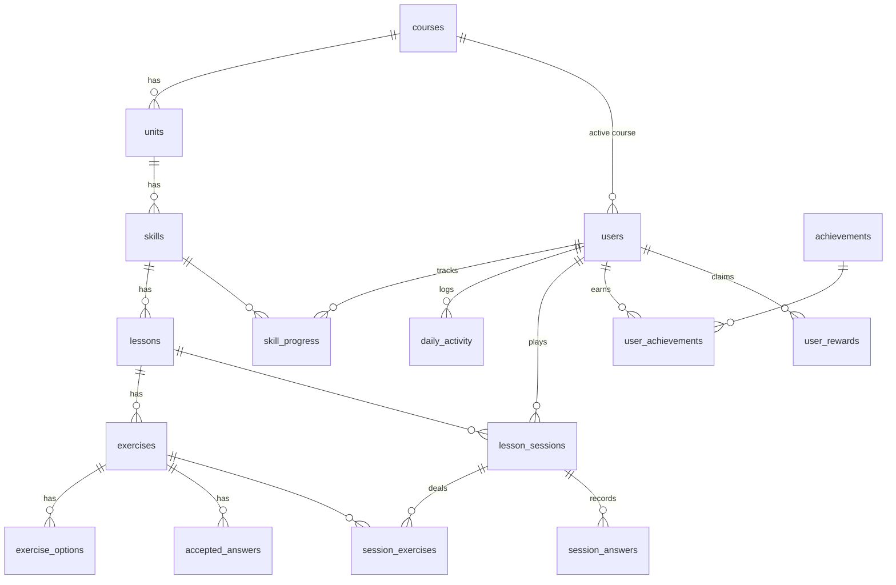

# lingo: a Duolingo-style language app

**Live demo:** https://duolingo-clone-kappa-virid.vercel.app &nbsp;·&nbsp; **API docs:** https://lingo-api-f305.onrender.com/docs

> The API runs on Render's free tier and sleeps when idle, so the first load can take up to a minute.

A full-stack recreation of Duolingo's learning experience: a snaking learning path, a lesson player with five exercise types and the signature feedback bar, hearts, XP, streaks, daily goals, a weekly league and achievements. Everything persists per learner in SQLite.

> The layout, interactions and palette follow the original app. The name, wordmark and mascot ("Pip") are original, to avoid reusing trademarked assets. See [D1](docs/DESIGN_DECISIONS.md#d1-copy-the-layout-palette-and-ux-but-not-the-brand-assets).

Design rationale for every non-obvious choice: **[docs/DESIGN_DECISIONS.md](docs/DESIGN_DECISIONS.md)**.

## Tech stack

| Layer | Technology | Why |
|---|---|---|
| **Frontend** | Next.js 16 (App Router), React 19, TypeScript | Required stack; App Router layouts give the shared app shell |
| | Tailwind CSS v4 + CSS design tokens | Fast styling; one token set for the whole palette |
| | SWR | Shared client cache, so the top bar, path and rail stay in sync |
| | canvas-confetti | Lesson-complete celebration |
| **Backend** | Python 3.11, FastAPI | Required stack; typed request/response models, auto docs at `/docs` |
| | SQLAlchemy 2.0 (typed ORM), Pydantic v2 | Schema as code; validated API contract |
| **Database** | SQLite | Required; foreign keys enforced per connection |
| **Tests** | pytest + FastAPI TestClient | 40 tests: unit and end-to-end API |

---

## Quick start

Prerequisites: Python 3.11+, Node 20+.

```bash
# 1. Backend  ->  http://localhost:8000  (API docs at /docs)
cd backend
python -m venv .venv
.venv\Scripts\activate          # Windows   (macOS/Linux: source .venv/bin/activate)
pip install -r requirements.txt
uvicorn app.main:app --reload --port 8000

# 2. Frontend ->  http://localhost:3000
cd frontend
npm install
cp .env.example .env.local      # NEXT_PUBLIC_API_URL=http://localhost:8000
npm run dev
```

The database is created and **seeded automatically on first start**, so the app is usable right away. To wipe and reseed: `python -m app.seed.run --reset`, or use **Settings → Developer tools → Reset demo data**.

Run the tests: `cd backend && pytest` (40 tests).

### Trying the time-based features
Streaks and heart regeneration depend on the calendar. Open **More (Settings) → Developer tools**:
- **Simulate next day** moves the server clock forward one day. Do a lesson to extend the streak, or skip two days to watch it break.
- **Reset clock** returns to real time.

---

## Features

### Core (all implemented)
- **Learning path**: 3 units, each laid out as ~6 stops like the original: lesson nodes, a **treasure chest** (claim gems once the levels above are done), a **personalized-practice** node and the unit trophy. Completed / active / locked states (locked nodes show their icon greyed out), a progress ring and START bubble on the active node, crown levels on completed nodes, sticky unit banners with a Guidebook button, node popovers, and a floating button that jumps back to your current lesson.
- **Top bar**: course flag, streak (with week calendar), XP (with daily-goal progress), gems, hearts (with regen countdown, refill and practice).
- **Lesson player**: multiple choice (picture cards and text), translate with a word bank, match pairs, fill in the blank, and type the answer. Spanish prompts have **hover hints** (dotted-underlined words show their meaning). It has "New word" and "Previous mistake" badges, encouragement screens ("Don't give up!" on the last heart, "You're on fire!" on a 5-answer combo), a progress bar with a combo label ("4 in a row", the bar turns gold on a hot streak), the chosen answer turning green when right (a wrong pick stays blue while the feedback bar turns red, as in the original), the feedback bar with the correct solution and Too easy / Too difficult / Report links, re-queued mistakes, Skip, keyboard shortcuts, and quit confirmation.
- **Hearts**: lose one per mistake; the first time you run out you get a one-time free refill, after that the modal offers gems, practice to earn hearts, or quit; lazy regeneration over time.
- **Completion flow**: "Lesson complete" stats (XP, accuracy, time) with confetti → daily-goal gem chest → streak extension screen → achievements unlocked → toasts for skill or unit completion. A **Review lesson** button lists every answer with the correct solution.
- **Dark mode**: follows the system setting or a Light / Dark / System choice in Settings, using the original's dark palette.
- **Gamification**: XP totals, daily goal (10/20/30/50), daily streak, weekly Bronze league with a promotion zone (unlocks after 10 completed lessons, with an "Unlock Leaderboards!" teaser for new learners), tiered achievements.
- **Profile**: banner header with avatar and edit button, Following/Followers (placeholder), stats (streak, total XP, current league, top 3 finishes, plus lessons, skills and crowns), and achievement progress with View all.
- **Quests and Shop**: daily quest with the countdown to reset and a "more quests unlock soon" card; shop with a Super banner, refill hearts for gems, and placeholders for Super, streak freeze and buying gems.
- **Help Center** (`/help`): an FAQ written for this app (streaks, leagues, hearts, gems and chests, crowns, daily goal, settings) in expandable category cards, plus a Send feedback form. Reached from More → Help, Settings → Help Center and the footer.
- **Page-specific right column**: e.g. "What are leaderboards?" on the league page, monthly challenges on Quests, friends on Profile. Plus a **More** menu (Settings / Help / Log out) in the sidebar.
- **Settings (Preferences)**: lesson-experience toggles saved per learner (sound effects, animations, motivational messages, listening/read-aloud), a Dark mode dropdown, daily goal, name, developer tools, and Account / Subscription / Support links (placeholders where the feature doesn't exist).
- **Placeholders ("Coming soon")**: Super, unlimited hearts, streak freeze, buying gems, speaking exercises, friends, notifications, other courses, guidebooks.

### Bonus (already in)
- Audio via browser text-to-speech, plus synthesized sound effects
- Achievements / badges system
- Real leaderboard across seeded users (same query ranks everyone)
- Responsive layout: phone (top bar + bottom tabs), tablet (icon sidebar), desktop (sidebar + right rail)
- Dark mode
- **Legendary challenge** (timed): on any completed skill, pay 100 gems for 10 questions in 3 minutes with at most 2 mistakes; win +40 XP and the skill turns gold. Timer and mistake limit are enforced by the server.

### Bonus (planned)
None: all bonus items are implemented.

---

## Architecture

```
┌──────────────────────── Next.js (client components) ─────────────────────────┐
│ app/(main)/learn, leaderboard, profile, shop, quests, settings  (app shell)  │
│ app/lesson/[skillId], app/practice                         (full-screen)     │
│        │ SWR cache: me · path · profile · leaderboard                        │
│        ▼                                                                      │
│ lib/api.ts: typed fetch client, ApiError(code)                               │
└────────┬─────────────────────────────────────────────────────────────────────┘
         │ JSON over HTTP (/api/*)
┌────────▼──────────────────────── FastAPI ────────────────────────────────────┐
│ api/routes      thin handlers ─┐                                             │
│ api/deps        current user, simulated clock, DB session                    │
│ api/serializers domain → Pydantic schemas (schemas/)                         │
│ services/       sessions · grading · hearts · streak · path ·                │
│                 achievements · leaderboard · users   (pure game rules)       │
│ core/           config · clock · domain errors                               │
│ models/         SQLAlchemy ORM  ───────────────►  SQLite                     │
│ seed/           authored content + exercise generator + demo learner/bots    │
└──────────────────────────────────────────────────────────────────────────────┘
```

**The lesson loop**

```
POST /sessions {skill_id}         → server picks the next lesson (or a review), deals exercises (no answers)
POST /sessions/{id}/answers  ×N   → graded server-side: {correct, solution, note, hearts}
     wrong → heart lost, exercise re-queued on the client
POST /sessions/{id}/complete      → validates everything was solved; awards XP, advances the skill,
                                    extends the streak, updates the daily goal, unlocks achievements
```

### Project structure
```
backend/
  app/
    main.py            app factory, CORS, error handler, startup seeding
    core/              config (env-tunable rules), clock, errors
    models/            course.py, user.py, achievement.py, system.py
    schemas/           API request/response models
    services/          game rules (no FastAPI imports)
    api/               deps, serializers, routes/{me,learn,dev}.py
    seed/              content.py (authored), generator.py, run.py
  tests/               test_units.py, test_api.py
frontend/
  src/app/             routes (App Router); help/faq.ts holds the Help Center content
  src/components/      layout/, path/, lesson/ (+ exercises/), ui, icons, Mascot
  src/lib/             api client, types, SWR hooks, theme, sound, format
docs/DESIGN_DECISIONS.md
```

---

## Database schema



| Table | Purpose | Key columns / constraints |
|---|---|---|
| `courses` | A language course | `code` unique (`es-en`) |
| `units` | Path sections | `course_id`, `position`, `color` theme · UNIQUE(course_id, position) |
| `skills` | Path nodes | `unit_id`, `position`, `icon` · UNIQUE(unit_id, position) |
| `lessons` | Lessons inside a skill | `skill_id`, `position`, `xp_reward` · UNIQUE(skill_id, position) |
| `exercises` | One question | `type` enum (5 types), `instruction`, `prompt`, `prompt_language`, `prompt_hints` (JSON word → meaning), `sentence`, `solution` |
| `exercise_options` | Choices / tiles / pairs | `text`, `match_text` (pairs), `image` (emoji), `is_correct` |
| `accepted_answers` | Alternative correct translations | `exercise_id`, `text` |
| `users` | Learner + hot counters + preferences | `total_xp`, `gems`, `hearts`, `hearts_updated_at`, `current_streak`, `longest_streak`, `last_streak_date`, `daily_goal_xp`, `timezone`, `is_bot`, `sound_enabled`, `animations_enabled`, `motivational_messages`, `listening_enabled` |
| `skill_progress` | Per-user skill progress | `lessons_completed`, `crowns`, `completed_at`, `legendary_at` · UNIQUE(user_id, skill_id) |
| `daily_activity` | XP per local day | `date`, `xp_earned`, `lessons_completed` · UNIQUE(user_id, date) |
| `lesson_sessions` | One attempt | uuid `id`, `mode` (lesson/review/heart_practice/legendary), `status` (active/completed/abandoned/failed), counters, `xp_earned`, `deadline` (timed sessions) |
| `session_exercises` | Exercises dealt into a session | `position` · UNIQUE(session_id, position) |
| `session_answers` | Every graded answer | `answer` (JSON), `is_correct`, `answered_at` |
| `achievements` | Tier definitions | `metric`, `threshold`, `title`, `icon` |
| `user_achievements` | Unlocked tiers | UNIQUE(user_id, achievement_id) |
| `user_rewards` | Gem rewards claimed (path chests, daily-goal chest) | `key` (e.g. `unit_chest:3`, `daily_goal:2026-11-11`), `kind`, `gems` · UNIQUE(user_id, key) makes claiming idempotent |
| `app_settings` | Key/value app state | simulated clock offset |

17 tables, 19 foreign keys and 14 unique constraints. Every ownership foreign key cascades on delete (18 of 19). The exception is `users.active_course_id`, a nullable reference that shouldn't delete a learner. Enums are stored as constrained strings. Foreign keys are enforced with `PRAGMA foreign_keys=ON` on every connection, since SQLite leaves them off by default.

---

## API overview

Base path `/api`. Interactive docs: `http://localhost:8000/docs`.
Errors always look like `{"error": {"code": "out_of_hearts", "message": "..."}}`.

| Method | Path | Description |
|---|---|---|
| GET | `/health` | Liveness check, used by Render's health check → `{"status": "ok"}` |
| GET | `/me` | Top-bar stats: hearts (+ seconds to next), gems, streak + week, XP, daily goal |
| PATCH | `/me` | Update `display_name`, `daily_goal_xp`, `timezone`, and the lesson preferences (`sound_enabled`, `animations_enabled`, `motivational_messages`, `listening_enabled`) |
| POST | `/me/hearts/refill` | Refill hearts for gems, or `{"free": true}` for the one-time free refill (`409 hearts_full / not_enough_gems / free_refill_used`) |
| GET | `/me/profile` | Stats, league rank, top-3 finishes, achievement families |
| GET | `/path` | Units → skills with `state`, `lessons_completed`, `crowns`, plus each unit's `chest` state |
| POST | `/path/units/{id}/chest` | Open a unit's treasure chest → `{gems_earned, gems}` (`403 chest_locked`, `409 chest_claimed`) |
| POST | `/sessions` | `{mode:"skill", skill_id}`, `{mode:"heart_practice"}` or `{mode:"legendary", skill_id}` → session + exercises (`403 skill_locked / skill_not_completed`, `409 out_of_hearts / not_enough_gems`) |
| POST | `/sessions/{id}/answers` | `{exercise_id, option_id \| option_ids \| text \| skipped}` → `{correct, solution, note, hearts, challenge_failed}` (`409 time_up` for late legendary answers) |
| POST | `/sessions/{id}/complete` | XP, accuracy, streak change, daily goal (+ `gems_earned` from the daily-goal chest), crowns, unlocked achievements (`409 session_incomplete`) |
| POST | `/sessions/{id}/abandon` | Quit a session |
| GET | `/leaderboard` | This week's league: `unlocked`, `lessons_to_unlock`, standings (empty while locked) |
| GET/PUT | `/dev/clock` | Read/set the simulated day offset (dev tools) |
| POST | `/dev/clock/advance` | +1 day |
| POST | `/dev/reset` | Wipe and reseed |

---

## Game rules (defaults, all in `backend/app/core/config.py`)

| Rule | Value |
|---|---|
| Hearts | 5 max; −1 per mistake (not in practice or match-pair taps); +1 every 60 min; one free refill the first time you run out, then 350 gems; heart practice = +1 |
| XP | lesson 10 (+5 perfect) · review 5 (+5 perfect) · heart practice 5 |
| Streak | +1 on the first completed lesson of a local day; resets after a missed day |
| Crowns | level 1 on finishing a skill, +1 per review, max 5 |
| League | unlocks after 10 completed lessons · weekly XP (Mon–Sun) · top 7 promotion zone · locked learners don't appear in others' standings |
| Legendary | 100 gems to enter · 10 questions · 3 minutes · max 2 mistakes · +40 XP, skill turns gold and crowns go to 5 |
| Gems | unit chest +15 (once per unit, after its first 2 skills) · daily goal +5 (once per day) · heart refill −350 |

---

## Seed data

- **Course**: Spanish for English speakers. 3 units ("Order in a café", "Food and animals", "Get around town") × 3 skills × 3 lessons × 7 exercises = **189 exercises**, all five types in every lesson.
- **Learner "Alex"**: 2 skills complete, the 3rd in progress, 10 completed sessions (so leagues are unlocked), a 4-day streak (active yesterday), 4/5 hearts, 520 gems, a chest ready to open, some achievements unlocked.
- **14 league competitors** with XP spread across the current week.

---

## Assumptions

- **Single default learner.** Auth is simplified as allowed: `get_current_user` returns the seeded learner. An `X-User-Id` header can switch users (used by tests).
- **One language** (Spanish). The schema supports more courses; the course switcher is a placeholder.
- **Gems are mocked**: seeded, earned from path chests and the daily-goal chest, and spent on heart refills. No purchases.
- **SQLite is recreated on deploy** on hosts with ephemeral disks. The seed runs on startup, so the demo always works; progress persists for the life of the instance.
- **Heart regen is 60 min per heart**: shorter than the original so it's demo-friendly. It's configurable.
- **Match-pair mismatches don't cost hearts**, since pairings are validated client-side for instant feedback.
- **Speech exercises** are out of scope (placeholder). Listening uses browser text-to-speech.
- **Theme preference** is stored per device (localStorage), not per user: it's a display setting, not progress.
- **Onboarding** (the original's first-run questionnaire) is not built: the brief assumes a default logged-in learner.
- **Dates**: datetimes are stored as naive UTC. Calendar days come from the learner's timezone, which the browser reports.

## Original work

All code was written for this project. Nothing is copied from existing clone repositories. The course content (vocabulary, sentences, exercises), the mascot, the icons (hand-drawn SVG) and the sound effects (synthesized with Web Audio) are original. No Duolingo assets, names, artwork, audio or fonts are used. The only scaffolding is the standard `create-next-app` setup, whose starter assets were removed.

## Deployment

| Part | Host | URL |
|---|---|---|
| Frontend | Vercel | **https://duolingo-clone-kappa-virid.vercel.app** |
| Backend API | Render (free) | https://lingo-api-f305.onrender.com (interactive docs: [`/docs`](https://lingo-api-f305.onrender.com/docs)) |

**Backend (Render).** The repo includes a Blueprint, [`render.yaml`](render.yaml): in Render choose **New → Blueprint**, pick this repository, and it creates the `lingo-api` web service with the settings below.

| Setting | Value |
|---|---|
| Root directory | `backend` |
| Build command | `pip install -r requirements.txt` |
| Start command | `uvicorn app.main:app --host 0.0.0.0 --port $PORT` |
| Health check | `/api/health` |
| `PYTHON_VERSION` | `3.11.9` |
| `CORS_ORIGIN_REGEX` | `https://.*\.vercel\.app` (lets any Vercel deployment call the API) |
| `ENABLE_DEV_TOOLS` | `true` (keeps "Simulate next day" for reviewers) |

**Frontend (Vercel).** Import the repository, set **Root Directory** to `frontend` (framework: Next.js, detected automatically) and add one environment variable:

| Variable | Value |
|---|---|
| `NEXT_PUBLIC_API_URL` | the Render URL, e.g. `https://lingo-api.onrender.com` (no trailing slash) |

**Free-tier behaviour (by design, see Assumptions):**
- The Render free instance **sleeps after ~15 minutes idle**, so the first request after that takes up to a minute while it wakes.
- Its disk is **ephemeral**, so the SQLite database is re-created and **re-seeded** whenever the instance restarts or redeploys. The demo always starts usable; progress lasts as long as the instance stays up.
